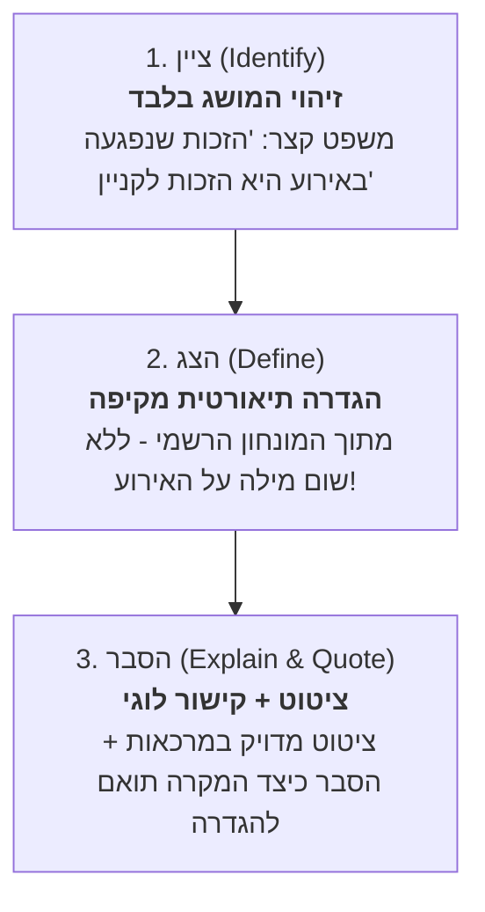

# מדריך המפמ״ר למענה על שאלת אירוע: מודל צה״ס
## ציין ➔ הצג ➔ הסבר (מודל חובה בבחינות הבגרות באזרחות)

---

## מהו מודל צה״ס ומדוע בוחני הבגרות דורשים אותו?
בבחינת הבגרות באזרחות, שאלות אירוע בודקות האם התלמיד אינו רק "משנן חומר", אלא מסוגל לזהות מושג תיאורטי במציאות, להגדיר אותו במדויק, ולהוכיח כיצד הוא מתממש בטקסט.

תשובה שלא בנויה לפי שלושת השלבים מאבדת נקודות יקרות במחוון!

---

## פירוט שלושת השלבים שלב-אחר-שלב

### 1. ציין (Identify) – 2-3 נקודות
* **מה עושים?** נוקבים בשם המדויק של המושג, הזכות, העיקרון או המנגנון שנשאלו עליו.
* **איך כותבים?**
  > "העיקרון הדמוקרטי שבא לידי ביטוי בקטע הוא **עקרון הגבלת השלטון**."
  > "הזכות שנפגעה בהחלטת העירייה היא **חופש העיסוק**."
* **מלכודות נפוצות:**
  - ❌ לא לכתוב שני מושגים שונים ("הזכות לקניין או אולי שוויון") – הבוחן יפסול את התשובה או יבדוק רק את הראשון.
  - ❌ לא לערבב בין זכות לעיקרון (אם שאלו על זכות, אל תענו "פלורליזם").

---

### 2. הצג (Present/Define) – 3-4 נקודות
* **מה עושים?** כותבים את ההגדרה התיאורטית המלאה של המושג מתוך מונחון האזרחות הרשמי.
* **כלל ברזל:** בשלב "הצג" **אסור להזכיר את האירוע או את הדמויות בקטע!** זהו קטע תיאורטי לחלוטין.
* **איך כותבים?**
  > "חופש העיסוק הוא זכותו של כל אדם לבחור במקצוע, תחום עבודה או מקור פרנסה כרצונו, ולפעול בו ללא הגבלות שרירותיות מצד השלטון."
* **מלכודות נפוצות:**
  - ❌ הגדרה חלקית (למשל: "חופש העיסוק זה לעבוד במה שרוצים" – מוריד נקודות במחוון!).
  - ❌ ערבוב האירוע בשלב ההצג ("חופש העיסוק זה שהעירייה לא תסגור את הקיוסק של משה").

---

### 3. הסבר (Explain & Quote) – 4-6 נקודות (חצי מהניקוד!)
* **מה עושים?** שלב זה מורכב תמיד משני תת-חלקים: **ביסוס (ציטוט)** ו**קישור (הסבר)**.
* **חלק א' - ציטוט מהטקסט:**
  > "בקטע נכתב: 'ראש העיר הודיע כי החל מהחודש הבא לא יחודשו רישיונות העסק לבעלי דוכני מזון ברחוב הראשי'..."
* **חלק ב' - קישור לוגי:**
  > "החלטה זו פוגעת בחופש העיסוק של בעלי הדוכנים, מכיוון שהיא שוללת מהם את האפשרות להמשיך ולהתפרנס ממשלח ידם הנבחר ומגבילה את תחום עיסוקם ללא הצדקה חוקית."
* **מלכודות נפוצות:**
  - ❌ ציטוט ללא הסבר (העתקת משפט בלבד).
  - ❌ הסבר כללי ללא ציטוט מהטקסט (איבוד 50% מניקוד ההסבר במחוון!).

---

## כיצד המערכת באתר בודקת צה״ס בצורה אוטומטית?
כדי לאפשר לתלמידים לתרגל צה״ס במחשב או בטלפון ולקבל ציון אמין ומיידי:
1. **מודל האימון המודרך (3-Stage Trainer):**
   - המערכת מפרקת כל שאלת אירוע לשלושה שלבים עוקבים.
   - בשלב 1 (ציין) התלמיד בוחר את המושג המדויק.
   - בשלב 2 (הצג) מוצגות 4 הגדרות – אחת מלאה ומדויקת, ושלוש חלקיות/מטעות (בדיוק המסיחים שמכשילים בבגרות).
   - בשלב 3 (הסבר) התלמיד נדרש לזהות את הציטוט והקישור הלוגי הנכון.
2. **מחוון בדיקה עצמית למענה פתוח:**
   - לתלמידים שרוצים להתאמן בכתיבה חופשית, המערכת מציגה תיבת כתיבה ולאחריה את **מחוון המפמ״ר המלא** עם נקודות ביקורת (Checklist) ודגם תשובה רשמי.
